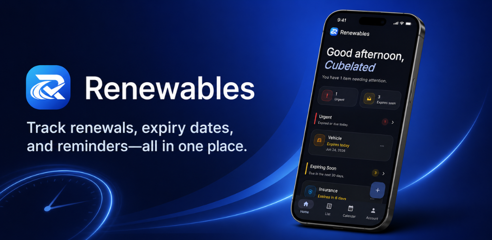

<p align="center">
  
</p>

<h1 align="center">Renewables Web</h1>

<p align="center">
  Official landing page for Renewables: Expiry Tracker
</p>

## About Renewables

Renewables helps individuals organize and track:

* Passports
* National IDs
* Driver licenses
* Insurance policies
* Memberships
* Subscriptions
* Certifications
* Warranties
* Other recurring renewals

Users receive reminders before important dates and can view upcoming deadlines through a clean and intuitive interface.

## Features

### Landing Page

* Modern responsive design
* Mobile-first experience
* Download links for mobile applications
* Product showcase and screenshots
* Feature overview

### Legal Pages

* Privacy Policy
* Terms of Service
* Support Page
* Account Deletion Instructions

### Performance

* Static site generation
* Optimized assets
* Fast global delivery through Cloudflare Pages

## Technology Stack

* React
* TypeScript
* Vite
* Tailwind CSS
* Cloudflare Pages
* Lucide React Icons

## Getting Started

### Install Dependencies

```bash
npm install
```

### Run Development Server

```bash
npm run dev
```

The application will be available at:

```text
http://localhost:5173
```

### Build Production Assets

```bash
npm run build
```

### Preview Production Build

```bash
npm run preview
```

## Project Structure

```text
src/
├── pages/
│   ├── LandingPage.tsx
│   ├── PrivacyPolicyPage.tsx
│   ├── TermsPage.tsx
│   └── SupportPage.tsx
│
├── components/
│   └── LegalLayout.tsx
│
├── App.tsx
└── main.tsx

public/
├── logo.png
├── app-phone.png
├── google-play-logo.svg
└── apple-logo.png
```

## Deployment

This project is designed for deployment on Cloudflare Pages.

### Build Command

```bash
npm run build
```

### Output Directory

```text
dist
```

## Support

For support, questions, bug reports, or account deletion requests:

**Email:** [cubelated@gmail.com](mailto:cubelated@gmail.com)

## Privacy

Renewables is committed to protecting user privacy.

Privacy Policy:

```text
/privacy
```

Terms of Service:

```text
/terms
```

Support:

```text
/support
```

## License

Copyright © 2026 Renewables.

All rights reserved.
